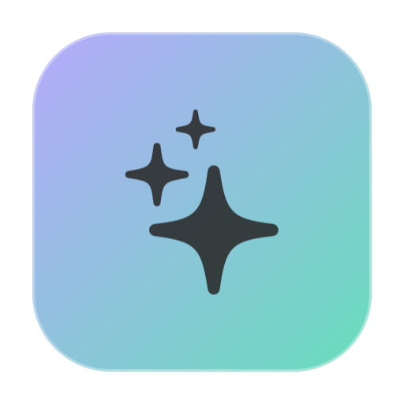
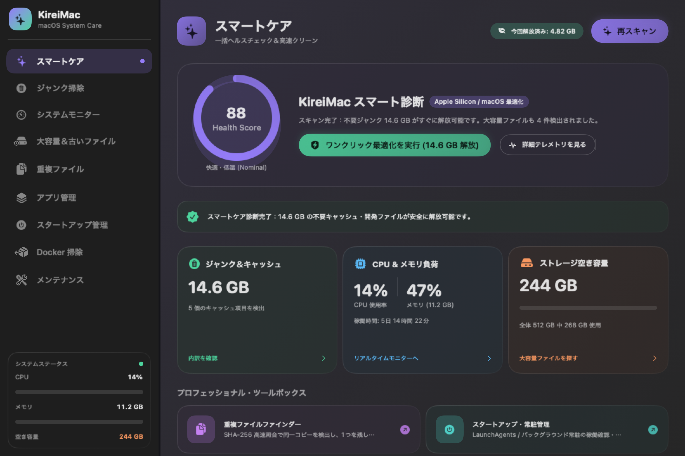
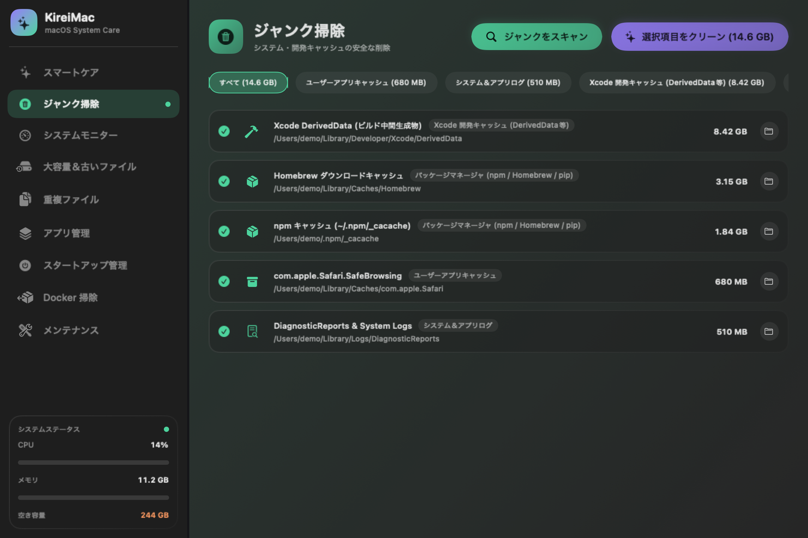
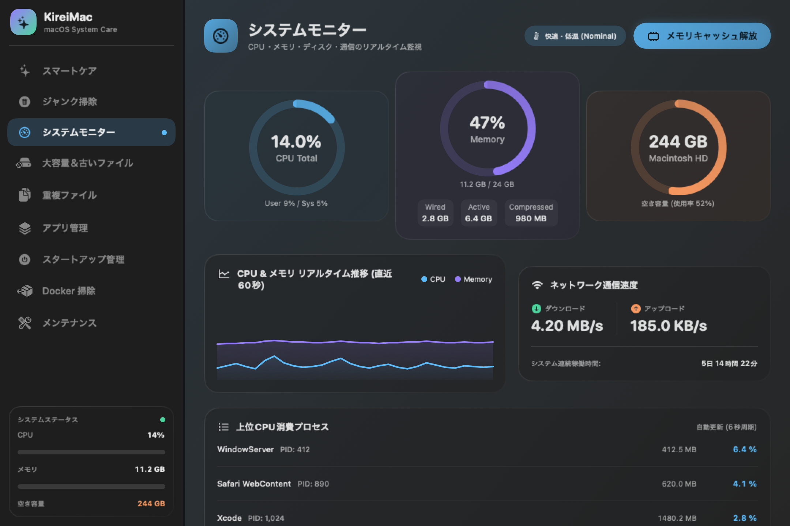
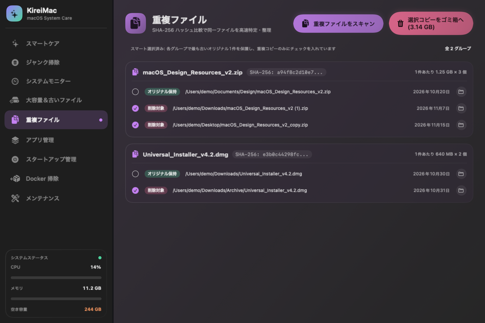
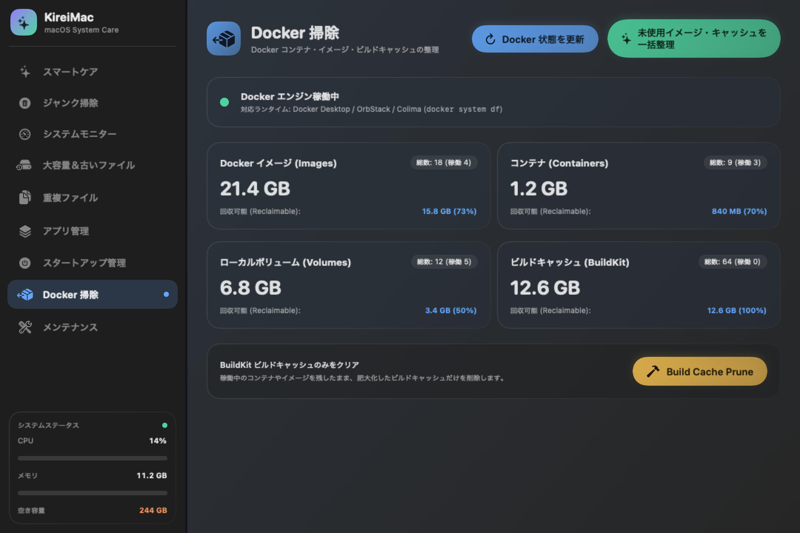

<div align="center">
  
  <h1>KireiMac（キレイ・マック）</h1>
  <p><strong>Mac を美しく、軽やかに整える。オープンソースのネイティブ macOS システムケア＆メンテナンススイート</strong></p>
  <p><em>Keep your Mac clean, organized, and fast — A native SwiftUI system maintenance utility with zero telemetry.</em></p>

  <p>
    <a href="https://github.com/yamajinoboru/KireiMac/releases/latest">
      
    </a>
    
    
    
    
  </p>
</div>

---

## ✨ 概要 (Overview)

**KireiMac** は、CleanMyMac のようなオールインワンの Mac メンテナンス体験を、**完全オープンソース・テレメトリ（外部送信）ゼロ・超軽量ネイティブ SwiftUI** で実現した macOS ユーティリティアプリです。  
MacBook Air / MacBook Pro / iMac / Mac mini / Mac Studio / Mac Pro すべての Mac で動作します。

- 🎨 **Modern Pastel Glass UI**: Apple 純正アプリや Linear にインスパイアされた、パステルカラーとグラスモーフィズムの洗練されたデザイン。
- 🛡️ **Trash-First の安全設計**: ファイル削除はいきなり完全消去せず、原則として macOS 標準の**「ゴミ箱へ移動 (`FileManager.trashItem`)」**を行うため、万が一の際もすぐに復元できます。
- ⚡ **アイドル時 CPU 負荷 1% 未満**: Darwin Mach カーネル API (`host_statistics64`, `getifaddrs`) を直接呼び出し、バックグラウンド常駐時もバッテリーや CPU を消費しません。

---

## 📸 スクリーンショット (Screenshots)

### 1. スマートケア (Smart Care Dashboard)
ワンクリックでキャッシュ・システム負荷・大容量ファイルを一括診断し、Mac の健康スコア（Health Score）を算出します。


### 2. ジャンク＆開発キャッシュ掃除 (Junk & Developer Cache Cleaner)
`~/Library/Caches`、ログ、Xcode (`DerivedData`, `Archives`)、Homebrew、npm/pnpm/Yarn、pip 等をカテゴリ別に可視化して安全にクリーンアップします。


### 3. リアルタイム・システムモニター (Real-time System Monitor)
CPU 負荷、メモリ内訳（Wired / Active / Compressed）、SSD 空き容量、ネットワーク送受信速度、上位プロセスをリアルタイム表示します。


### 4. 重複ファイルファインダー (Duplicate File Finder)
3段階パイプライン（サイズ一致 → 先頭4KBハッシュ → SHA-256 完全照合）で同一ファイルを高速特定。オリジナル1件を自動保護する「スマート選択」を搭載。


### 5. Docker コンテナ＆ビルドキャッシュ掃除 (Docker Cleaner)
Docker Desktop / OrbStack / Colima のディスク使用量を分析し、肥大化したイメージや BuildKit キャッシュをワンクリックで Prune します。


---

## 🚀 搭載されている全 9 モジュール (9 Core Modules)

| モジュール | 主な機能 |
| :--- | :--- |
| **1. スマートケア (`Smart Care`)** | ジャンク診断＋DNSキャッシュフラッシュ＋メモリ整理をワンクリックで一括実行 |
| **2. ジャンク掃除 (`Junk Cleaner`)** | ユーザーキャッシュ、ログ、Xcode `DerivedData`、Homebrew / npm / pip キャッシュ、ゴミ箱の整理 |
| **3. システムモニター (`System Monitor`)** | CPU・RAM内訳・SSD容量・通信速度（KB/s, MB/s）・上位プロセスのリアルタイム監視 |
| **4. 大容量＆古いファイル (`Large Files`)** | ホーム配下から 20MB〜1GB 以上の巨大ファイルや長期間未更新のファイルを抽出 |
| **5. 重複ファイル (`Duplicate Finder`)** | CryptoKit SHA-256 で重複コピーを高速検出し、オリジナルを残して一括でゴミ箱へ移動 |
| **6. アプリ管理 (`App Uninstaller`)** | アプリ本体（`.app`）だけでなく、`~/Library` 内に散らばる関連残骸（Leftovers）を検出・一括削除 |
| **7. スタートアップ管理 (`Startup Manager`)** | `LaunchAgents` / `LaunchDaemons` の稼働状態確認と、ワンクリック停止・無効化 |
| **8. Docker 掃除 (`Docker Cleaner`)** | `docker system df` の可視化と、未使用イメージ・BuildKit ビルドキャッシュの一括解放 |
| **9. メンテナンス (`Maintenance`)** | DNSフラッシュ、LaunchServices 再構築、フォントキャッシュ削除、RAM整理、Time Machine 整理 |

さらに、macOS 右上の**メニューバーにも常駐 (`MenuBarExtra`)** し、いつでも現在の `CPU % | RAM %` の確認と「クイック高速化」を実行できます。

---

## 📦 ダウンロード＆インストール方法 (Download & Installation)

### 方法 A: Homebrew でワンライナーインストール（一番かんたん・検疫解除も全自動）

Homebrew をお使いの方は、以下のコマンドだけで `/Applications/KireiMac.app` への配置と Gatekeeper 検疫フラグ解除（`xattr -cr`）まで全自動で行われます：

```bash
brew tap yamajinoboru/tap
brew install --cask kireimac
```

---

### 方法 B: GitHub Releases から直接ダウンロード（ビルド不要）

[**👉 最新リリース (Releases) ページ**](https://github.com/yamajinoboru/KireiMac/releases/latest) から、お好みの形式をダウンロードしてください。

- **💿 [`KireiMac-v1.0.0.dmg` を直接ダウンロード](https://github.com/yamajinoboru/KireiMac/releases/download/v1.0.0/KireiMac-v1.0.0.dmg)（一般ユーザー向け・おすすめ）**:  
  ダブルクリックしてマウントし、中の `KireiMac.app` を隣の `Applications` フォルダへドラッグ＆ドロップしてください。
- **📦 [`KireiMac-v1.0.0-macOS.zip` を直接ダウンロード](https://github.com/yamajinoboru/KireiMac/releases/download/v1.0.0/KireiMac-v1.0.0-macOS.zip)（軽量アーカイブ版）**:  
  解凍して出てきた `KireiMac.app` を `/Applications` に移動してください。

> ⚠️ **初回起動時に「開発元を検証できないため開けません」または「壊れているため開けません」と表示された場合**:  
> 本アプリは無料のオープンソースプロジェクトであり Apple 有料公証（Notarization）を通していないため、ブラウザ経由でダウンロードすると macOS の検疫フラグ（Quarantine）が付与されます。  
> `/Applications` に配置したあと、ターミナルで以下の1行を実行すると即座に起動できるようになります：
> ```bash
> xattr -cr /Applications/KireiMac.app
> ```

---

### 方法 B: ソースコードから自分でビルドする (Build from Source)

#### 必要環境 (Requirements)
- **macOS 14.0 (Sonoma)** 以降
- **Xcode 15.0+** または **Swift 5.10+ Command Line Tools**

#### 1. リポジトリのクローンと `.app` / `.dmg` のビルド

付属のビルドスクリプトを実行するだけで、Release バイナリのコンパイル、高解像度アプリアイコン (`AppIcon.icns`) の生成、コード署名まで自動で行われ、`dist/KireiMac.app` が生成されます。

```bash
git clone https://github.com/yamajinoboru/KireiMac.git
cd KireiMac

# Release ビルド & KireiMac.app バンドルの生成
zsh scripts/bundle_app.sh

# (オプション) 配布用 .dmg と .zip の生成
zsh scripts/package_release.sh v1.0.0

# アプリを起動
open dist/KireiMac.app
```

#### 2. `/Applications` フォルダへのインストール

日常的に使う場合は、`/Applications` にコピーしてください：

```bash
cp -Rf dist/KireiMac.app /Applications/
```

> 💡 **ヒント（フルディスクアクセスについて）**  
> 一部のシステムキャッシュやゴミ箱フォルダをより深くスキャンしたい場合は、`システム設定 > プライバシーとセキュリティ > フルディスクアクセス` に `KireiMac.app` を追加してください。

---

## 🛠️ 開発者向けコマンド (Development)

```bash
# 単体テストの実行
swift test

# デモスクリーンショットの再生成（個人情報・ローカル環境を一切含まない匿名データで出力）
./dist/KireiMac.app/Contents/MacOS/KireiMac --export-demo-screenshots docs/screenshots
```

---

## 📄 ライセンス (License)

このプロジェクトは [MIT License](LICENSE) の下で公開されています。個人・商用問わず自由にご利用・改変いただけます。
